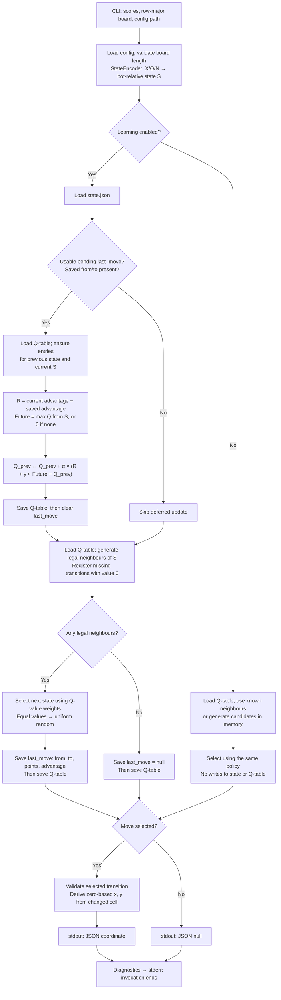

# Q-learning Runtime

One CLI invocation observes a board and returns one bot move. The caller owns the game loop and sends the updated board and scores on the next invocation. Learning therefore evaluates the saved transition after the opponent has moved.

| Component (`games_theory/`) | Responsibility |
| --- | --- |
| `process.py` | CLI validation, learning/read-only routing and JSON output |
| `src/config_repository.py` | Load runtime configuration |
| `src/default_predictor.py` | Evaluate the previous move and predict the next one |
| `src/domain_types.py` | Shared board, score, configuration, pending-move, Q-table and coordinate contracts |
| `src/predictor/` | StateEncoder, StateRepository, QTableRepository, RewardPolicy, ScoreTracker and ActionSelector |
| `src/generator.py` | Generate candidate bot moves |
| `src/move_coordinate_deriver.py` | Convert a selected transition into `{x, y}` |
| `resources/resource.py` | Initialize resources and provide file utilities |

| Resource under `DIR/data/` | Owner / contents |
| --- | --- |
| `config.json` | ConfigRepository: board size, bot symbol, learning flag |
| `state.json` | StateRepository: pending `last_move` (`from`, `to`, `points`, `advantage`) |
| `qtable.json` | QTableRepository: canonical-state → next-state → value; initialized empty and populated lazily |

`Q ← Q + α × (reward + γ × max_future_Q − Q)`, with default `α = 0.1`, `γ = 0.5`. Reward is the change in bot score advantage. Equal action values use uniform random selection; otherwise selection is weighted, shifting nonpositive values to positive weights.

The Q-table and pending state are separate JSON writes, not one transaction. Missing files load as an empty Q-table or no pending move; malformed JSON propagates an error. Read-only prediction does not write resources. Round-boundary detection, episode history and explicit terminal learning are future work in [INBOX](../../INBOX.md).
